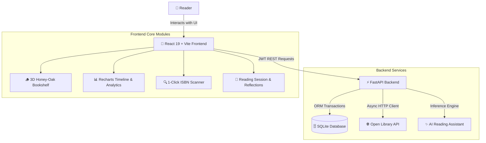

# 📚 Book Buddy — Personal Reading Tracker & Sanctuary

An elegant, full-stack personal reading tracking platform built with **FastAPI**, **React 19**, and a classic **3D Skeuomorphic Apple iBooks-inspired Bookshelf UI**. 

Book Buddy allows readers to catalog physical and digital books, track page-by-page reading progress, analyze reading velocity over time through interactive visualizations, record personal reflections, automatically import book metadata via natural Title/Author search or ISBN barcode, and receive intelligent reading insights powered by an AI assistant.

> **🚀 Live Web Application**: [https://book-buddy-sigma-flax.vercel.app/](https://book-buddy-sigma-flax.vercel.app/)  
> **🔑 Evaluator Demo Credentials**:
> - **Email**: `reviewer@sayonetech.com`
> - **Password**: `DemoReviewer2026!` *(pre-populated with 15 curated books, reading logs, and telemetry)*

---

## 🏛️ System Architecture



---

## 🚀 Setup Steps

### 1. Prerequisites
Ensure you have the following installed on your machine:
- **Python**: `3.10` or higher
- **Node.js**: `18.0` or higher (with `npm`)
- **Git**

---

### 2. Backend Setup (FastAPI)

1. **Open a terminal** and navigate to the project root directory:
   ```bash
   cd "Book Buddy"
   ```

2. **Create and activate a Python virtual environment**:
   - **Windows (PowerShell)**:
     ```powershell
     python -m venv backend/venv
     .\backend\venv\Scripts\Activate.ps1
     ```
   - **macOS / Linux**:
     ```bash
     python3 -m venv backend/venv
     source backend/venv/bin/activate
     ```

3. **Install backend dependencies**:
   ```bash
   pip install -r backend/requirements.txt
   ```

4. **Configure environment variables**:
   Create a `.env` file in the project root (or verify the existing `.env`):
   ```env
   # Generate a secure key via: python -c "import secrets; print(secrets.token_hex(32))"
   SECRET_KEY=your_generated_secret_key_here
   DATABASE_URL=sqlite:///./book_buddy.db
   GEMINI_API_KEY=your_gemini_api_key_here
   ```

5. **Start the FastAPI backend server**:
   ```bash
   uvicorn backend.main:app --reload --port 8000
   ```
   - The API will be live at: `http://127.0.0.1:8000`
   - Interactive Swagger API Documentation: `http://127.0.0.1:8000/docs`
   - Health check probe: `http://127.0.0.1:8000/api/health`

---

### 3. Frontend Setup (React 19 + Vite)

1. **Open a second terminal** and navigate to the `frontend/` directory:
   ```bash
   cd "Book Buddy/frontend"
   ```

2. **Install frontend dependencies**:
   ```bash
   npm install
   ```

3. **Start the Vite development server**:
   ```bash
   npm run dev
   ```
   - The application will open at: `http://localhost:5173`

---

## 🌐 Cloud Deployment Guide (Vercel + Render)

Book Buddy is pre-configured for seamless cloud deployment using **Render** for the backend API and **Vercel** for the React frontend.

### Step 1: Deploy Backend on Render
1. Push your code to your GitHub repository.
2. Sign in to [Render](https://render.com) and click **New +** $\rightarrow$ **Web Service**.
3. Connect your GitHub repository.
4. Fill in the service details:
   - **Name**: `book-buddy-api`
   - **Runtime**: `Python 3`
   - **Build Command**: `pip install -r backend/requirements.txt`
   - **Start Command**: `uvicorn backend.main:app --host 0.0.0.0 --port $PORT`
5. Under **Environment Variables**, add:
   - `SECRET_KEY`: *(Generate a 64-character random string)*
   - `DATABASE_URL`: *(Render Managed PostgreSQL internal connection URL or SQLite)*
   - `GEMINI_API_KEY`: *(Your Google AI Gemini key)*
6. Click **Deploy Web Service** and copy your backend URL (e.g., `https://book-buddy-api.onrender.com`).

### Step 2: Deploy Frontend on Vercel
1. Sign in to [Vercel](https://vercel.com) and click **Add New...** $\rightarrow$ **Project**.
2. Import the same GitHub repository.
3. Configure the project settings:
   - **Framework Preset**: `Vite`
   - **Root Directory**: `frontend`
   - **Build Command**: `npm run build`
   - **Output Directory**: `dist`
4. Under **Environment Variables**, add:
   - `VITE_API_BASE_URL`: `https://book-buddy-api.onrender.com` *(your Render backend URL from Step 1)*
5. Click **Deploy**. Vercel will build and launch your application globally at: [https://book-buddy-sigma-flax.vercel.app/](https://book-buddy-sigma-flax.vercel.app/)

---

## 🌟 Comprehensive Feature List

### 1. Complete Book Lifecycle Management
- **Add New Volumes**: Add books with title, author, total pages, genre, publication year, custom cover artwork URL, and personal notes.
- **Edit & Update**: Modify any book's metadata, page count, cover art, rating, or personal reflections at any time.
- **Delete with Confirmation**: Cleanly delete books with cascading cleanup of associated reading logs.
- **Multi-Filter & Sorting**:
  - Filter by reading state: *All Volumes*, *Reading Now*, *Completed*, or *Wishlist*.
  - Filter by Genre (dynamically aggregated from your library).
  - Sort by *Recently Read*, *Title (A-Z)*, *Rating (Highest)*, or *Progress (Pages)*.
  - Live instant search across titles and authors.

### 2. 3D Skeuomorphic Wooden Bookshelf UI
- **Authentic Apple iBooks Aesthetic**: Features honey-oak woodwork, hand-crafted crown moldings, solid oak upright side pillars, and 3D beveled shelf ledges.
- **Physical Book Placement**: Books stand upright directly on wooden planks with contact shadows and realistic depth.
- **Dynamic Shelf Expansion**: Automatically calculates responsive viewport column width and dynamically appends new shelf rows as your library grows.
- **Empty Shelf Experience**: Displays 3 polished wooden shelf tiers with an invitation placard when your library is ready for its first volume.

### 3. Page Progress & Reading Velocity Tracking
- **Interactive Reading Session Logger**: Record the current page reached and minutes spent reading in each session.
- **Automatic State Transitions**: Updating a book's current page automatically shifts its status from *Wishlist* to *Reading Now*, and reaching the final page marks it as *Completed*.
- **Velocity Metrics**: Computes reading speed in **Pages per Hour** and **Words per Minute (WPM)** based on session duration.
- **Historical Reading Logs**: View a complete chronological timeline of every reading session per book with date stamps, pages read, and session durations.

### 4. Open Library Auto-Import & Title Search
- **Title / Author Search**: Instant search by book title, author, or keyword without requiring an ISBN barcode.
- **ISBN Barcode Lookup**: Direct 1-click import using standard 10-digit or 13-digit ISBNs.
- **Auto-Populated Metadata**: Populates title, author, total page count, publication year, and high-resolution cover artwork.
- **Genre Normalization**: Automatically classifies raw catalog tags into the app's 9 clean canonical genres (*Technology*, *Software Engineering*, *Self-Help*, *Fiction*, *Science Fiction*, *Business*, *Psychology*, *Biography*, *History*), keeping the analytics chart pristine.

### 5. Interactive Analytics & Visualizations (Recharts)
- **Antique Brass Metric Plaques**:
  - Total Volumes Cataloged
  - Current Reading In-Progress
  - Completed Volumes & Completion Rate
  - Total Pages Read & Reader Satisfaction
- **Reading Velocity Timeline Area Chart**: Displays daily pages consumed over time with smooth gradient fills and customized hover tooltips.
- **Genre Balance & Distribution Donut Chart**: Visual breakdown of your reading tastes across canonical genres.

### 6. AI Reading Assistant (Three-Tier Intelligence Engine)
- **Three-Tier Recommendations**:
  1. *Tier 1 (Google Gemini AI)*: Deeply personalized suggestions prompted with your genre profile and an explicit exclusion list of books you already own, with covers resolved dynamically.
  2. *Tier 2 (Open Library Trending)*: Acclaimed circulating titles in your top genres with cover artwork.
  3. *Tier 3 (Curated Library Classics)*: Zero-network offline fallback catalog.
  - Transparent attribution badges (*Google Gemini AI*, *Open Library Trending*, or *Curated Classics*).
- **Pace Analysis & Completion Forecasting**: Calculates daily velocity from reading logs and forecasts completion dates.
- **Executive Summaries**: Synthesizes notes and reading progress into high-level recaps.
- **Thoughtful Review Generator**: Automatically drafts structured reader reflections and reviews based on your rating and progress with 1-click clipboard copy.

### 7. Security, Tenant Isolation & Demo Account
- **JWT Authentication**: Secure user registration and login with HMAC-SHA256 tokens.
- **Password Security**: Passwords hashed using industry-standard `bcrypt`.
- **Strict Data Isolation**: Every book, reading session, and statistic is isolated to the authenticated user via FastAPI's dependency injection (`Depends(get_current_user)`).
- **Evaluator Demo Account**: Pre-seeded with 14 curated volumes across all reading states, reading logs, and timeline data:
  - **Email**: `reviewer@sayonetech.com`
  - **Password**: `DemoReviewer2026!`
- **Restricted CORS**: Cross-origin policy restricted strictly to local environments and verified application domains.

---

## 📡 API Reference Overview

FastAPI automatically serves interactive API documentation at:
- **Swagger UI**: [http://127.0.0.1:8000/docs](http://127.0.0.1:8000/docs)
- **ReDoc**: [http://127.0.0.1:8000/redoc](http://127.0.0.1:8000/redoc)

### Primary Endpoints

| Method | Endpoint | Description | Auth Required |
| :--- | :--- | :--- | :---: |
| `GET` | `/api/health` | Lightweight health check & cloud container probe | No |
| `POST` | `/api/auth/register` | Register a new reader account | No |
| `POST` | `/api/auth/login` | Authenticate and obtain JWT access token | No |
| `GET` | `/api/auth/me` | Fetch authenticated user profile | Yes |
| `GET` | `/api/books` | List books (supports search, genre filter, and sort) | Yes |
| `POST` | `/api/books` | Add a new volume to the library | Yes |
| `GET` | `/api/books/{id}` | Retrieve book details and reading progress | Yes |
| `PUT` | `/api/books/{id}` | Update book metadata, rating, or cover | Yes |
| `DELETE` | `/api/books/{id}` | Remove volume and delete reading logs | Yes |
| `POST` | `/api/books/{id}/progress` | Log a reading session (pages read, duration) | Yes |
| `GET` | `/api/books/{id}/logs` | Retrieve session history for a book | Yes |
| `GET` | `/api/stats/summary` | Aggregate statistics (totals, pages, ratings) | Yes |
| `GET` | `/api/stats/timeline` | Daily reading timeline data for charts | Yes |
| `GET` | `/api/stats/genres` | Genre distribution data for charts | Yes |
| `GET` | `/api/isbn/{isbn}` | Auto-lookup book metadata from Open Library | Yes |
| `POST` | `/api/ai/recommend` | Generate recommendations (excludes library) | Yes |
| `POST` | `/api/ai/summarize` | Generate reading summaries and reflections | Yes |
| `POST` | `/api/ai/generate-review` | Generate structured review from notes & rating | Yes |
| `GET` | `/api/ai/predict-completion/{id}` | Calculate completion forecast for an active book | Yes |

---

## 📁 Project Directory Structure

```text
Book Buddy/
├── backend/
│   ├── routes/
│   │   ├── auth.py          # Authentication (register, login, JWT)
│   │   ├── books.py         # Book CRUD & progress tracking
│   │   ├── stats.py         # Reading analytics & chart aggregations
│   │   ├── isbn.py          # Open Library ISBN lookup integration
│   │   └── ai.py            # AI reading assistant endpoints
│   ├── auth.py              # Password hashing & JWT token validation
│   ├── database.py          # SQLAlchemy 2.0 engine & session maker
│   ├── main.py              # FastAPI application entrypoint & CORS
│   ├── models.py            # SQLAlchemy database models (User, Book, Log)
│   ├── schemas.py           # Pydantic validation schemas
│   ├── seed_data.py         # Scoped demo reviewer catalog seeder
│   └── requirements.txt     # Python backend dependencies
│
├── frontend/
│   ├── src/
│   │   ├── api/
│   │   │   └── client.js              # Axios API client with in-flight cold start tracking
│   │   ├── components/
│   │   │   ├── AIStudioModal.jsx      # AI reading assistant & recommendations modal
│   │   │   ├── AuthModal.jsx          # User login & registration modal
│   │   │   ├── BookCard.jsx           # 3D book spine & card component
│   │   │   ├── BookDetailModal.jsx    # Book overview, notes & quick actions
│   │   │   ├── BookModal.jsx          # Add & Edit volume modal with ISBN scanner
│   │   │   ├── GenreChart.jsx         # Recharts genre distribution chart
│   │   │   ├── Navbar.jsx             # Top navigation & user controls
│   │   │   ├── ProgressModal.jsx      # Reading session logger modal
│   │   │   ├── StatsOverview.jsx      # Metric plaques (pages, completion pace)
│   │   │   └── TimelineChart.jsx      # Recharts daily reading timeline
│   │   ├── context/
│   │   │   └── AuthContext.jsx        # JWT session provider & demo evaluator login
│   │   ├── App.jsx                    # Main application & dynamic shelf logic
│   │   ├── index.css                  # Custom wooden bookshelf design system
│   │   └── main.jsx                   # React root entrypoint
│   ├── package.json                   # Frontend scripts & dependencies
│   └── vite.config.js                 # Vite bundler & backend proxy config
│
├── .env                     # Environment variables (JWT secret, DB URL)
├── book_buddy.db            # Local SQLite database file
└── README.md                # Project documentation
```

---

## 🛠️ Tech Stack Summary

- **Backend**: FastAPI, Uvicorn, SQLAlchemy 2.0, Pydantic v2, Python-Jose (JWT), Passlib / Bcrypt, HTTPX
- **Frontend**: React 19, Vite, Recharts, Lucide React, Axios
- **Database**: SQLite (Zero configuration, high portability)
- **Styling**: Vanilla CSS custom design system (Warm honey-oak wood, parchment paper, brass plaques, 3D shadows)
